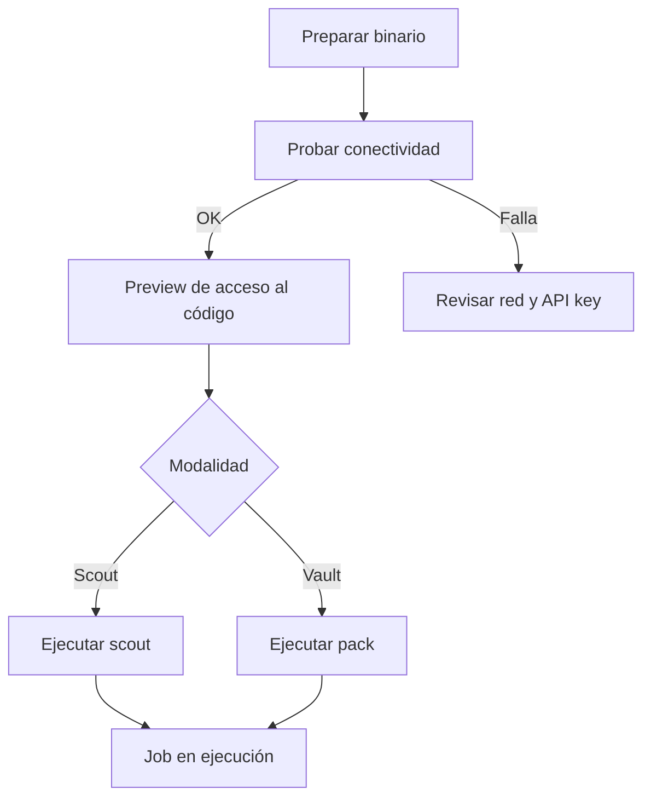

# Guía de Ejecución: Quantum Vault y Scout

## 1. Introducción

QuickScan ofrece dos modalidades de análisis de código fuente:

| Modalidad | Qué hace | ¿El código sale del entorno del cliente? |
|-----------|----------|------------------------------------------|
| **Scout** | Ejecuta el análisis de código de manera remota coordinada. | **No** |
| **Vault** | Empaqueta (`pack`) el repositorio para su análisis y genera el reporte. | Según el flujo de empaquetado |

Ambas modalidades usan el mismo binario de línea de comandos y se diferencian por el subcomando y la API key utilizada.

> **Seguridad:** esta guía usa marcadores como `<API_KEY_SCOUT>` y `<API_KEY_VAULT>`. Las claves reales se solicitan al equipo responsable por un canal seguro. Nunca se deben guardar en repositorios, tickets ni documentos compartidos.

## 2. Prerrequisitos

- Binario correspondiente al sistema operativo (ver sección 3).
- Una API key válida para Scout y/o para Vault.
- Salida a internet por los puertos **22** y **443** hacia los servicios de QuickScan.
- Ruta local al código fuente a analizar.
- `curl` instalado (para la prueba de conectividad).

## 3. Binarios disponibles

| Sistema operativo | Arquitectura | Binario |
|-------------------|--------------|---------|
| macOS | Intel (amd64) | `quantum-vault-scout-darwin-amd64` |
| macOS | Apple Silicon (arm64) | `quantum-vault-scout-darwin-arm64` |
| Linux | amd64 | `quantum-vault-scout-linux-amd64` |
| Linux | arm64 | `quantum-vault-scout-linux-arm64` |
| Windows | amd64 | `quantum-vault-scout-windows-amd64.exe` |

### 3.1 Preparar el binario (macOS / Linux)

```bash
# Dar permisos de ejecución (ajustar el nombre al binario elegido)
chmod +x ./quantum-vault-scout-darwin-arm64
```

En macOS, si el sistema bloquea el binario por no estar firmado:

```bash
xattr -d com.apple.quarantine ./quantum-vault-scout-darwin-arm64
```

En Windows se ejecuta desde PowerShell o CMD: `.\quantum-vault-scout-windows-amd64.exe`.

> **Nota:** en los ejemplos siguientes se usa `./quantum-vault-scout` como alias genérico. Sustituya por el nombre real del binario descargado. El README original usa nombres abreviados (`quantum-vault-linux-amd64`) que pueden diferir del nombre del archivo entregado.

## 4. Flujo general de ejecución



## 5. Paso 1: Prueba de conectividad

Verifica que la infraestructura del cliente puede alcanzar el servicio (puertos 22 y 443).

```bash
curl -s -X POST "<URL_API_QUICKSCAN>/v1/jobs" \
  -H "Content-Type: application/json" \
  -H "x-api-key: <API_KEY_SCOUT>" \
  -d '{"Project":"prueba-conectividad"}'
```

`<URL_API_QUICKSCAN>` es la URL base del servicio, suministrada por el equipo QuickScan.

### Interpretación del resultado

| Resultado | Significado | Acción |
|-----------|-------------|--------|
| Retorna `JOB_ID` y `EXECUTION_TOKEN` | Conectividad y API key correctas | Continuar |
| `TIME_OUT` | La salida está bloqueada desde la infraestructura del cliente | Solicitar al área de redes habilitar los puertos 22 y 443 |
| `403` | API key no registrada o invalidada | Solicitar una clave vigente |

## 6. Paso 2: Preview de acceso al código

Confirma que el binario puede leer el código fuente antes de lanzar el análisis.

```bash
./quantum-vault-scout preview --repo "/ruta/al/codigo"
```

**Recomendaciones:**

- Escriba la ruta entre comillas dobles.
- (Opcional) Si la carpeta tiene caracteres especiales o espacios, renómbrela para evitar errores.

## 7. Paso 3A: Ejecución de Scout

Inicia el análisis de código de forma remota. **El código no sale del entorno del cliente.**

```bash
./quantum-vault-scout scout --path "/ruta/al/codigo" \
  --api-key "<API_KEY_SCOUT>"
```

| Parámetro | Obligatorio | Descripción |
|-----------|-------------|-------------|
| `--path` | Sí | Ruta al código fuente |
| `--api-key` | Sí | API key de Scout |

## 8. Paso 3B: Ejecución de Vault

Empaqueta el repositorio y lanza el proceso de análisis.

```bash
./quantum-vault-scout pack --repo "/ruta/al/codigo" \
  --client "<NOMBRE_CLIENTE>" \
  --project "<NOMBRE_PROYECTO>" \
  --api-key "<API_KEY_VAULT>" \
  --lang "Espanol"
```

| Parámetro | Obligatorio | Descripción |
|-----------|-------------|-------------|
| `--repo` | Sí | Ruta al código fuente |
| `--client` | Sí | Nombre del cliente (sin espacios, use guiones) |
| `--project` | Sí | Nombre del proyecto |
| `--api-key` | Sí | API key de Vault |
| `--lang` | No | Idioma del reporte. Por defecto: Español |

## 9. Solución de problemas

| Síntoma | Causa probable | Acción |
|---------|----------------|--------|
| `TIME_OUT` en la prueba de conectividad | Firewall o proxy bloquea la salida | Habilitar puertos 22 y 443 |
| `403` | API key inválida, no registrada o de otra modalidad | Verificar que usa la clave de Scout para `scout` y la de Vault para `pack` |
| `permission denied` al ejecutar | Binario sin permisos | `chmod +x` |
| macOS bloquea el binario | Cuarentena de Gatekeeper | Quitar atributo con `xattr -d com.apple.quarantine` |
| Error al leer la ruta | Espacios o caracteres especiales | Usar comillas dobles o renombrar la carpeta |
| `exec format error` | Binario de arquitectura incorrecta | Elegir amd64 o arm64 según `uname -m` |

---

### Historial de Cambios

| Fecha | Autor | Descripción |
|-------|-------|-------------|
| 2026-11-10 | Kiro | Versión inicial, derivada de README.md sin datos sensibles |
